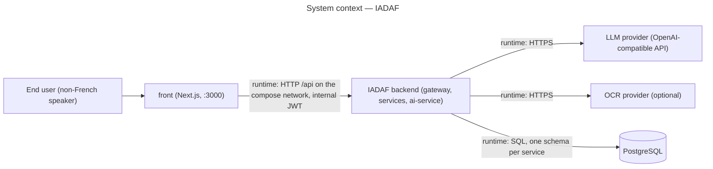

# Architecture dossier

The single entry point to IADAF's conception documents: how the backend is structured, which
decisions shape it, and how to read the folder. Since ADR-0001 was accepted, code conforms to
this dossier and a change that makes them diverge updates both.

## Scope

The backend as deployed by `docker-compose.yml`: `api-gateway`, `discovery-service`, the four
Spring Boot services (`user`, `demarches`, `document`, `analytics`) and `ai-service` (FastAPI).
The Next.js front is drawn only as the client of the gateway; its internals belong to the front
team.

## Stakeholders and goals

| Stakeholder | What the dossier gives them |
|---|---|
| Ismail (product owner, tech lead) | Decisions to accept, reject or re-weight, with the arguments on the page. |
| Backend team (Corentin, Benoît) | The rules every backend PR is reviewed against, and the order of the refactoring steps. |
| Front team | The backend contracts that change (verdict ownership, error bodies). |
| School jury | A justified architecture, not a tour of the code. |

Goals: make the document completeness verdict testable without mocks, make the fine-tuned model
and the vision reader a configuration plus one adapter, and remove dead infrastructure before
May 2027.

## Method

- Docs-as-code: Markdown and Mermaid in git, reviewed in pull requests like code.
- Lightweight hybrid: decisions as MADR (Markdown Architectural Decision Records) in
  `decisions/`, numbered once, never renumbered (`ADR-0001`); diagrams in UML 2.5 notation at a
  stated C4 zoom level (the C4 model's context, container, component and code views); use
  cases and traceability to follow
  with the first feature study.
- Every choice between options is argued with a weighted decision matrix inside the ADR, so a
  reviewer can contest a weight or a score rather than the conclusion (agreed with ADR-0001;
  added to CONTRIBUTING in a follow-up once PR #34 is merged).

## Context (C4 level 1)

## How to read the folder

| Path | What it holds |
|---|---|
| `decisions/` | Architecture decision records. Start with `0001-adopt-proportional-clean-architecture.md`. |
| `diagrams/architecture/` | Component diagrams of the target structure (gateway and discovery, `demarches-service`, `ai-service`). |
| `glossary.md` | Every term used in the diagrams and ADRs, defined once. |
| `specs/` | Studies that feed a decision: `ai-model-selection.md` (pre-trained model selection, ISM-117) and `ai-training-plan.md` (free compute and budget triggers, December 2026 to May 2027). |

Not yet written, by design: `traceability-matrix.md` and `diagrams/<feature>/01-use-case*.md`.
No use case is formalised yet; the first feature study (document completeness check, Linear
ISM-111) will add them.

## Related documents

- `CONTRIBUTING.md` § 3 and `AGENTS.md` § Before changing code (both arrive with PR #34) — a
  plan, and for a new feature an approved diagram, before the code.
- [docs/rgpd](../rgpd/) — DPIA (data protection impact assessment) and other data-protection
  documents (in French).
