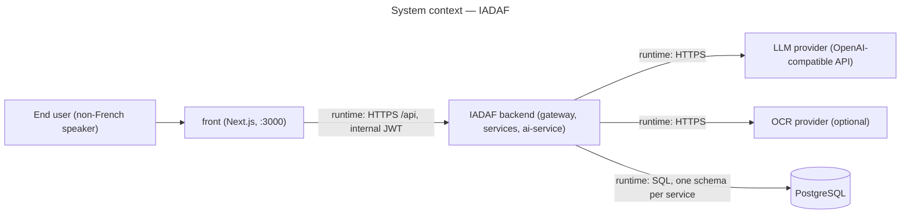

# Architecture dossier

The single entry point to IADAF's conception documents: how the backend is structured, which
decisions shape it, and how to read the folder. Code conforms to this dossier, not the reverse;
when they diverge, the change that fixes one updates the other.

## Scope

The backend as deployed by `docker-compose.yml`: `api-gateway`, `discovery-service`, the four
Spring Boot services (`user`, `demarches`, `document`, `analytics`) and `ai-service` (FastAPI).
The Next.js front is drawn only as the client of the gateway; its internals belong to the front
team.

## Method

- Docs-as-code: Markdown and Mermaid in git, reviewed in pull requests like code.
- Decisions as MADR records in `decisions/`, numbered once, never renumbered
  (`ADR-0001`).
- Diagrams in UML 2.5 notation, one question per diagram, grouped by feature under
  `diagrams/<feature>/`; the C4 zoom level is stated in each title.
- Every choice between options is argued with a weighted decision matrix inside the ADR, so a
  reviewer can contest a weight or a score rather than the conclusion.

## Context (C4 level 1)

## How to read the folder

| Path | What it holds |
|---|---|
| `decisions/` | Architecture decision records. Start with `0001-adopt-proportional-clean-architecture.md`. |
| `diagrams/architecture/` | Component diagrams of the target structure (gateway and discovery, `demarches-service`, `ai-service`). |
| `glossary.md` | Every term used in the diagrams and ADRs, defined once. |

Not yet written, by design: `traceability-matrix.md` and `diagrams/<feature>/01-use-case*.md`.
No use case is formalised yet; the first feature study (document completeness check, Linear
ISM-111) will add them.

## Related documents

- [CONTRIBUTING.md](../../CONTRIBUTING.md) § 3 — the conception gate (an approved diagram before
  a new feature).
- [docs/rgpd](../rgpd/) — DPIA and data-protection documents (in French).
