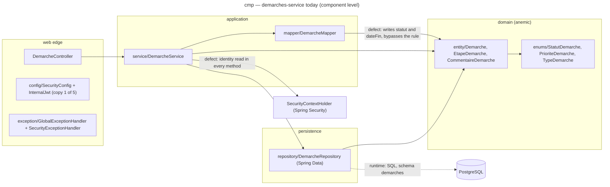
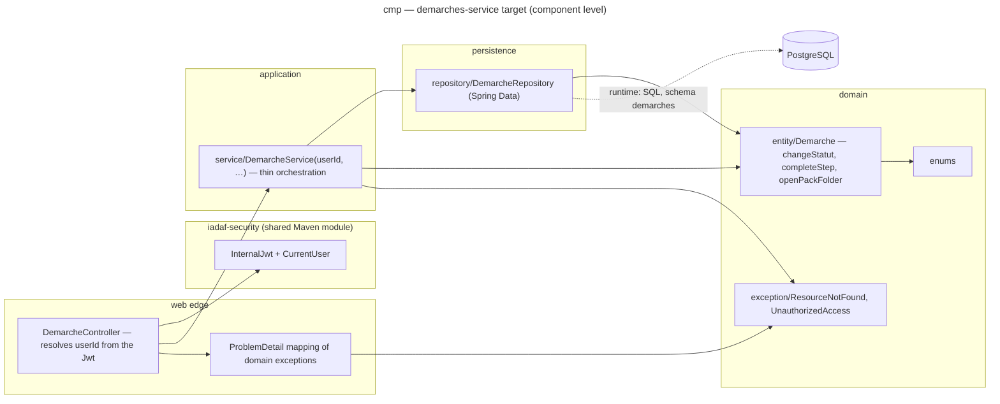

# Component diagram — architecture — demarches-service, before and after ADR-0001

> **Feature**: architecture — Linear ISM-116 (under ISM-111)
> **Related ADRs**: ADR-0001
> **Realises**: no use case yet (style decision) · **See also**: `03b-component-ai-service.md`,
> `03c-component-gateway-discovery.md`

## Context

What `demarches-service` depends on today and what it depends on once ADR-0001 rules 1 and 2
apply (identity at the edge, invariants on the entity). Component level inside one container;
arrows are compile-time dependencies pointing to the supplier. Not covered: the other Java
services (same shape, same fix), the HTTP routes, the lifecycle of a procedure.

## Diagram — today (dev_v1 f3e7328)

## Diagram — target (ADR-0001, after steps 2 to 4)

## Notes

- The only two arrows that change direction or disappear are the defects: the service no
  longer reaches `SecurityContextHolder`, and the mapper no longer writes business fields.
  `DemarcheDTO.of(entity)` (a static factory, as `document-service` does) replaces the mapper
  bean.
- No port on the repository: Spring Data's interface is already the seam, and there is one
  persistence technology. The ADR names the trigger that would add one.
- `document-service` has the same shape and the same identity defect
  (`DocumentService.java:151-158`); it also throws `ResponseStatusException` from the service,
  which rule 1 moves to the edge. Not drawn twice.
- Open question carried by ADR-0001: 8 of the 12 endpoints have no caller; removing them
  (step 1) shrinks `DemarcheService` before step 3 touches it.
