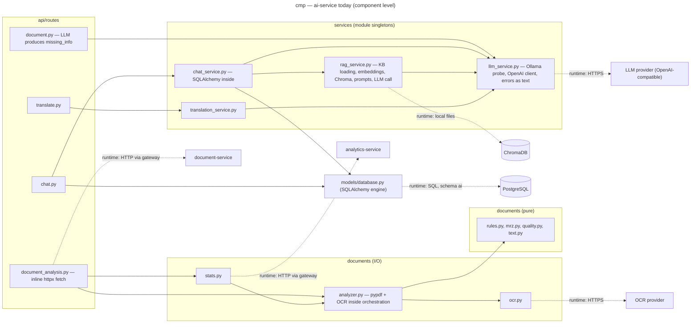
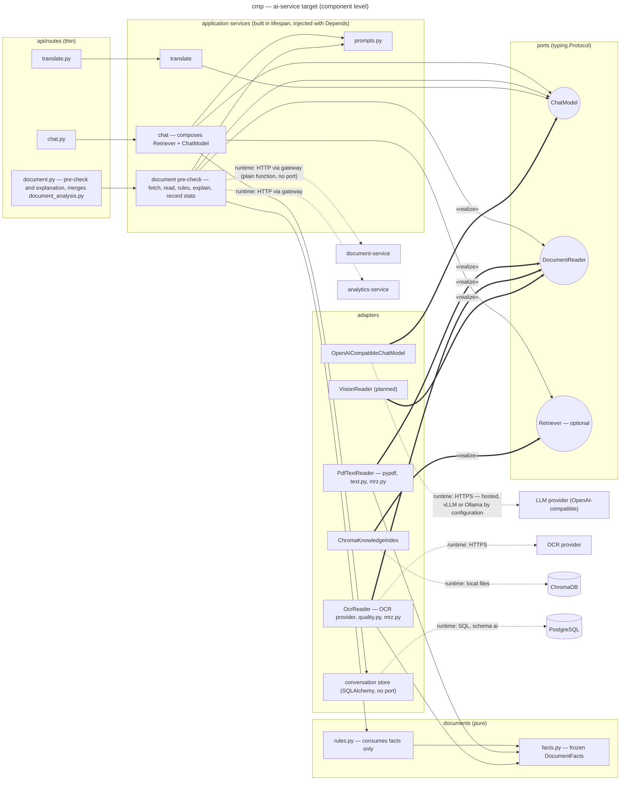

# Component diagram — architecture — ai-service, before and after ADR-0001

> **Feature**: architecture — Linear ISM-116 (under ISM-111)
> **Related ADRs**: ADR-0001
> **Realises**: no use case yet (style decision) · **See also**:
> `03a-component-demarches-service.md`, `03c-component-gateway-discovery.md`

## Context

Where the three justified ports of ADR-0001 rule 3 sit in `ai-service`, and which modules keep
a plain dependency. Component level inside one container; arrows are compile-time dependencies
pointing to the supplier; `runtime:` edges are network calls. Not covered: the chat and
document HTTP contracts, `users.py` (GDPR erasure) and `health.py`, the knowledge-base
ingestion script, the Eureka registration (see `03c`).

## Diagram — today (dev_v1 f3e7328)

## Diagram — target (ADR-0001, after steps 5 to 7)

## Notes

- Three ports, each with a named trigger: `ChatModel` (fine-tuned model with role-tagged
  prompts, ISM-111), `DocumentReader` (vision reader planned; two adapters already exist),
  `Retriever` (RAG is optional at runtime, tests run without ChromaDB).
- `rules.py → facts.py` replaces today's `analyzer.py → pypdf / OCR`: the rules never see raw
  text or a library type. The text, MRZ and quality parsers move beside the readers that
  produce `DocumentFacts`, where raw text and image bytes belong. A detected kind that differs
  from the declared pack label becomes a deterministic "type mismatch" rule, not a model opinion.
- `document_analysis.py` and its document-service fetch merge into the pre-check application
  service: the fetch is a plain function, the stats call keeps its single egress point.
- The conversation store keeps a plain dependency: one database, and the ownership rule
  (`may_resume`) becomes a pure function tested with values.
- Not drawn, on purpose: an embeddings port, a vector-store port, a translation port, a
  `DocumentSource` protocol for the httpx fetch.
