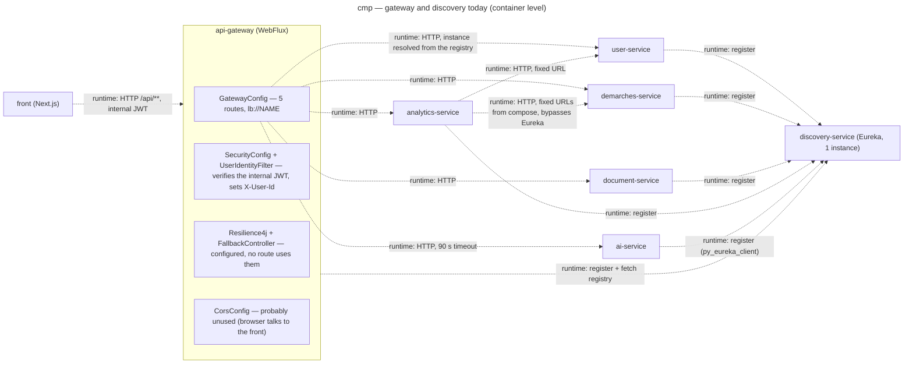
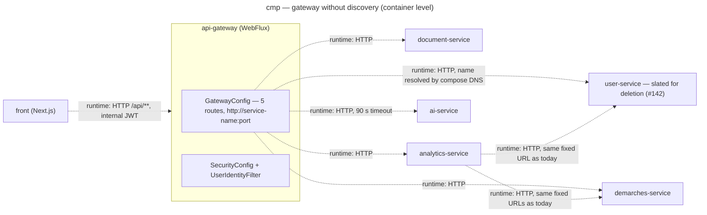

# Component diagram — architecture — gateway and service discovery, two options

> **Feature**: architecture — Linear ISM-116 (under ISM-111)
> **Related ADRs**: ADR-0001 (decision 1: keep Eureka)
> **Realises**: no use case yet (style decision) · **See also**:
> `03a-component-demarches-service.md`, `03b-component-ai-service.md`

## Context

How a request reaches a service today, and the registry-free alternative that was not
chosen. Container level (one box per deployable); solid arrows are compile-time dependencies,
`runtime:` edges are network calls. ADR-0001 decision 1 keeps Eureka; the second diagram stays
as the documented alternative. Not covered: TLS termination (Caddy), the front's own routes,
the JWT contract itself. Inside the gateway box the security filter chain and the routes are
wired by Spring at runtime, so no compile-time edge joins them.

## Diagram — today (dev_v1 f3e7328)

## Diagram — option without a registry (compose DNS)

## Notes

- What Eureka buys at runtime today: nothing observable. Every service runs as one container with a
  fixed compose name; `analytics-service` already addresses its peers by those names and the
  gateway's discovery locator is disabled on purpose. What it costs: a container and its
  healthcheck on the critical startup path, a client library in six services (including a
  Python one that fails silently when the registry is down), and the two-peer cluster profile
  that no environment uses.
- Decision (ADR-0001, decision 1): keep `discovery-service`, a school requirement to
  demonstrate service discovery, and use it consistently. The two `Ana` fixed-URL edges of the
  first diagram leave with the analytics aggregator (step 1, #144); any future call between
  backend services (calls through the gateway excluded) resolves through the registry like the
  gateway's routes.
- The registry-free option stays documented in case the school requirement goes away.
- Independent of the Eureka decision, step 1 of ADR-0001 deletes the circuit-breaker
  configuration, the fallback controller, the `X-Gateway` header and, after one check that the
  browser never calls `:8080` directly, `CorsConfig`.
- The gateway's JWT verification is the fifth copy of the contract; step 2 (`iadaf-security`)
  shares `InternalJwt` while each service keeps its own filter chain (WebFlux here, servlet
  elsewhere).
