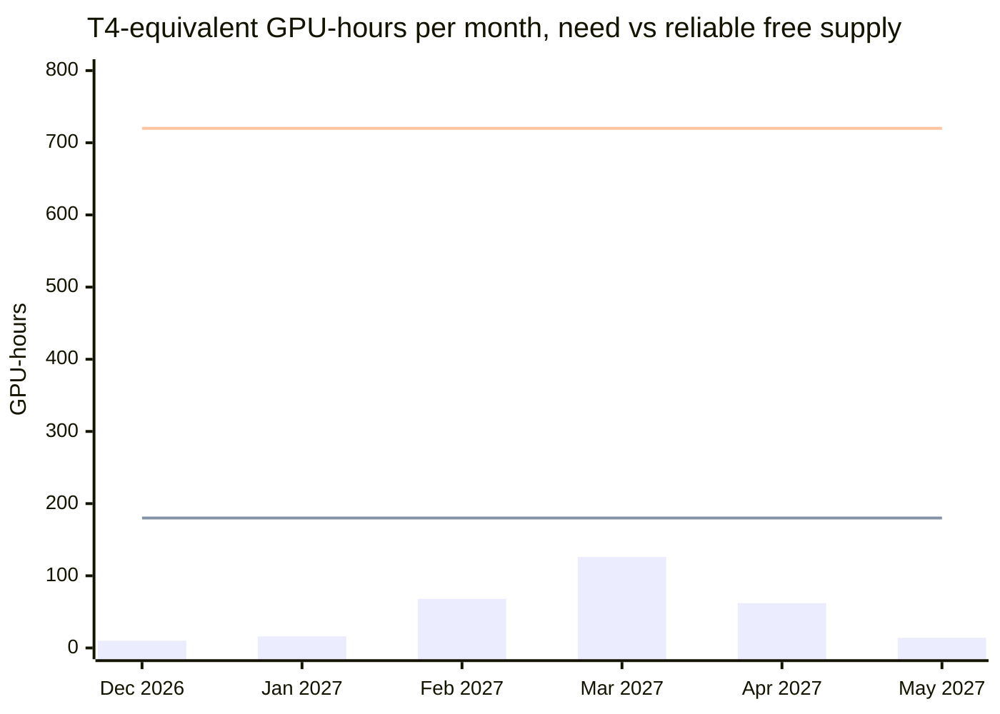
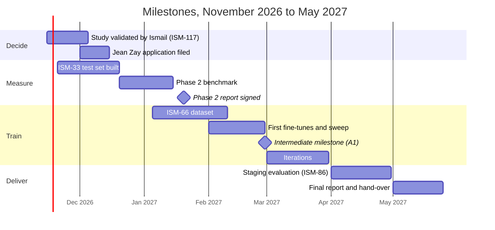

# AI training plan: free compute, December 2026 to May 2027

This plan simulates what free GPU offers allow from December 2026 to May 2027 for the benchmark and fine-tuning of the selected model, under three scenarios, with the budget triggers, the GDPR items for the DPIA (ISM-64) and a glossary for beginners.

Status: proposal, 2026-11-05, Linear ISM-117. Author: Benoît (backend). Reviewers: the data/AI role of the Users and AI pole (co-signer to be named by Ismail), Corentin, then Ismail, product owner and tech lead. Companion of the model selection study (`ai-model-selection.md`). Every figure is an estimate from vendor pages and guides retrieved on 2026-11-05; quotas move, so they must be re-read before each monthly plan.

## 1. Summary

- The free compute is not the bottleneck. One contributor's accounts give about 180 reliable T4-hours a month; the plan needs at most about 126 hours, margin included (105 without), in its busiest month (March 2027).
- Four accounts (one per contributor, one account per service, never two accounts on one service) multiply the ceiling by four and, more usefully, let four runs go in parallel within the 12-hour session caps.
- Jean Zay (GENCI/IDRIS dynamic access, up to 50,000 GPU-hours a year, no publication duty under that ceiling, academic sponsor required) is the only free path to sustained work above 14 B parameters or to full fine-tuning (Modal's H100 credits, about 7.5 hours a month per account, allow one-off runs only); it is a lever, not a need, and the application should be filed in December 2026 to be usable in February 2027.
- The real cost is serving, not training: a self-hosted model in staging needs a GPU on 24/7. The three budget triggers (§ 5) are built around that.
- The human time (8 hours a week per contributor, assumption A2) is the scarce resource: 25 hours of grading in Phase 2, dataset work in ISM-66, run supervision.

## 2. Assumptions

Owner inputs asked on 2026-11-05 (the model selection study lists them as A1 to A9). This plan depends on A1 (milestone end of February 2027, delivery May 2027), A2 (8 h/week per contributor, 4 contributors), A6 (synthetic data only until the DPIA is validated) and A7 (0 € acquired).

Technical assumptions, each one a figure to replace by a measurement after the first run:

| # | Assumption | Value used | Basis |
|---|---|---|---|
| T1 | Training method | QLoRA (4-bit base, LoRA adapters) with Unsloth | fits an 8 B model in 6 to 10 GB of VRAM, a 14 B in 12 to 14 GB, on a 16 GB T4 |
| T2 | Fine-tuning dataset size (ISM-66) | 2,000 examples of about 1,000 tokens, so 2 M tokens per epoch | order of magnitude for a tone-language-format fine-tune on two procedures |
| T3 | T4 throughput with Unsloth, 8 B QLoRA | about 1,200 tokens/s | a vendor benchmark gives about 4,500 tokens/s on a 16 GB RTX 4060 Ti; a T4 is roughly 3 to 4 times slower; unverified on a T4 |
| T4 | Hours per 8 B run | 3 h (3 epochs at 0.5 h each, plus evaluation and checkpoint overhead) | T2 and T3 |
| T5 | Hours per 14 B run | 7 h | about 2.2 times the 8 B, and the VRAM margin forces smaller batches |
| T6 | Hours per 4.5 B run | 1.5 h | half the 8 B |
| T7 | Benchmark inference | 1 h per model on 300 items with vLLM on a T4 | vision inputs included; the baselines through the API cost no GPU |
| T8 | Session discipline | runs cut into 9 to 12 h segments, a checkpoint pushed to a private Hugging Face Hub repository every 30 minutes and at every epoch, resume from the last checkpoint | Kaggle and Colab cap sessions at 12 h; Modal free GPUs are preemptible; Lightning free studios restart every 4 h |
| T9 | Loss to preemption and restarts | 20 % of GPU time | planning margin, to measure |
| T10 | H100 to T4 ratio for training | 1 H100-hour is worth about 8 T4-hours | rough ratio for QLoRA workloads; unverified |

Checkpoint discipline, stated once: a run that cannot resume is a run that will be lost; every notebook starts by looking for the last checkpoint of its run id, and the training loop saves at a fixed step interval, not only at the end of an epoch.

## 3. Free compute inventory

Recurring quotas per account, T4-equivalent hours a month. "Reliable" counts only Kaggle and Modal; the others are bonuses.

| Service | Quota | GPU | T4-h per month | Counted as | Status of the figure |
|---|---|---|---|---|---|
| Kaggle Notebooks | about 30 h/week, shown in the account settings, reset Saturday 00:00 UTC; sessions 12 h | 2 × T4 16 GB (two separate memories) or P100 16 GB | about 130 | reliable | guides agree on about 30 h/week; Kaggle publishes no fixed number; phone verification required |
| Modal (Starter) | 30 $/month of compute credits | T4 to H100 | about 50 (T4 at about 0.59 $/h) or about 7.5 H100-h (about 3.95 $/h) | reliable | official pricing page; some guides say a card must be linked |
| Google Colab (free) | not published, dynamic; sessions up to 12 h | T4 16 GB, not guaranteed | about 70 | bonus | Google states the limits are dynamic; 70 h is a guide's estimate |
| Lightning AI (free) | 15 credits; reported to have become a one-time starter grant in September 2026 | T4 (0.19 $/h) | about 20 once (up to 80 if still monthly) | one-time bonus | sources conflict; to check on the pricing page before counting it |
| Paperspace Gradient (free) | 6 h sessions, random availability | M4000 8 GB | 0 for this plan | not usable | 8 GB cannot hold an 8 B QLoRA run |
| SSP Cloud (Insee, France) | on request, 1 GPU per user | varies | 0 planned | bonus, EU-hosted | the only free option hosted in France apart from Jean Zay |

One-shot credits (once per account, 30 to 90 days): Google Cloud about 300 $, Azure about 200 $, Oracle 300 $, GitHub Student Pack (contents vary), AMD Developer Program. Each is a joker of a few dozen GPU-hours, with a bank card and a GPU quota request; they are kept out of the monthly simulation and listed as trigger T2's first fallback.

Programmes on application: Jean Zay (GENCI/IDRIS) dynamic access, filed any time on eDARI, up to 50,000 GPU-hours and 48 simultaneous GPUs on one year, no publication duty under those ceilings, an academic sponsor (a teacher-researcher of the school) and a research project description, about 3 to 6 weeks of lead time; Google TPU Research Cloud (students accepted, code to port to TPU, results to share); EuroHPC AI Playground (startups and laboratories). NVIDIA Inception is for companies only.

Fine-tuning as a service: Mistral (EU-hosted, free experiment tier since 2024, 2026 pricing on quote, a per-job minimum and a monthly storage fee reported), Hugging Face AutoTrain and Jobs (paid GPUs, free tier uncertain), Together and Fireworks (a few dollars of credits, US-hosted), OpenAI (no free tier, weights not returned). They are scored in the model selection study; this plan counts no hours from them.

## 4. Simulation, December 2026 to May 2027

### 4.1 Need per month

A worst-case envelope: 14 B runs are booked in February to April in case the 14 B finalist wins Phase 2; if a smaller model wins, those hours drop.

| Month | Work | 8 B runs | 14 B runs | 4.5 B runs | Benchmark h | Need, T4-h | Need with 20 % margin (T9) |
|---|---|---|---|---|---|---|---|
| 2026-12 | environment, prompts, Phase 2 benchmark on 4 finalists, Jean Zay application | 0 | 0 | 0 | 8 (4 models, reruns) | 8 | 10 |
| 2027-01 | Phase 2 report; ISM-66 dataset (synthetic generation goes through the API, no GPU); smoke fine-tunes, two per size | 2 | 0 | 2 | 4 | 13 | 16 |
| 2027-02 | milestone (A1); first real fine-tunes on the winner, hyper-parameter sweep | 10 | 3 | 0 | 6 | 57 | 68 |
| 2027-03 | iterations: data formats, epochs, a DPO or ORPO trial if ISM-66 adds preference pairs; busiest month | 20 | 5 | 0 | 10 | 105 | 126 |
| 2027-04 | final candidates, staging evaluation (ISM-86), accuracy measure for the DPIA | 10 | 2 | 0 | 8 | 52 | 62 |
| 2027-05 | final benchmark, report, hand-over | 2 | 0 | 0 | 6 | 12 | 14 |
| **Total** | | 44 | 10 | 2 | 42 | **247** | **296** |

### 4.2 Supply per scenario

| Scenario | Who | Reliable T4-h per month | With bonuses | Over 6 months, reliable |
|---|---|---|---|---|
| S1 One account | one contributor (Kaggle + Modal) | 180 | 250 | 1,080 |
| S2 Four accounts | four contributors, one account each per service | 720 | 1,000 | 4,320 |
| S3 Four accounts + Jean Zay | S2 plus a dynamic-access allocation usable from February 2027 | 720 plus the allocation (2,000 H100-h requested, worth about 16,000 T4-h under T10) | | far above any need of this plan |

### 4.3 Chart: need against supply

Bars: need with margin (§ 4.1). Lower line: S1, one account. Upper line: S2, four accounts. S3 is off the chart.

### 4.4 Reading the simulation

- S1 covers the need every month, with the March peak at 70 % of the reliable supply; the 12-hour session cap, not the quota, is what slows a single account: a 7-hour 14 B run fits one session, a sweep of ten 8 B runs takes three days of back-to-back sessions.
- S2 is the recommended scenario: it costs nothing, each contributor stays within the terms of use (one account per service), and sweeps run in parallel. Its real benefit is calendar time, not hours.
- S3 changes what is possible, not what is needed: with Jean Zay the team could fine-tune a 24 B model, run full fine-tuning instead of QLoRA, or train on more data, and the data would stay in France. The application costs one afternoon and a sponsor's signature, provided students of a private school are eligible for dynamic access (unverified, to ask IDRIS); the plan does not depend on it.
- The human constraint dominates: at 8 h/week for each of the 4 contributors assumed in A2, the AI work has about 140 person-hours a month in total. Phase 2 grading (25 h), dataset building (ISM-66, likely 60 h or more) and run supervision compete for it. A sweep of twenty runs needs someone to launch, watch and log them; the plan's March peak assumes two contributors on it.

## 5. Budget triggers

Each trigger names the observation that fires it, why free compute cannot absorb it, and the order of magnitude to ask the school. None is fired today (A7).

| Trigger | Fires when | Why free compute is not enough | Ask | Order of magnitude |
|---|---|---|---|---|
| B1 Quota exhaustion | the Kaggle weekly quota is hit two weeks in a row during the February or March sweeps and Colab gives no GPU | the sweep's calendar time slips past the milestone | one month of Colab Pro, or a Modal top-up | 12 to 50 € |
| B2 Larger model wins | Phase 2 shows the 14 B finalist beating the 8 B by more than 5 points of J2 field-F1, and Jean Zay is not granted by end of February | 14 B runs on a T4 take 7 h each and leave no VRAM margin; an A100 80 GB does them in under 2 h | 60 to 100 hours of rented A100 or H100 (about 2 to 4 €/h), after the one-shot cloud credits are spent | 150 to 300 € |
| B3 Self-hosted serving in staging | the Phase 2 winner is a self-hosted model, Ismail confirms self-hosting over an EU-hosted API (issue #130 suggests a hosted API as a likely compromise; no decision is taken), and ISM-86 needs the model up 24/7 for the April evaluation | no free offer hosts a model continuously; a free GPU session is 4 to 12 h | a small GPU VPS or a serverless endpoint for 3 months, or the EU-hosted API pay-per-use (near 0 € at school volume) | 300 to 900 € over 3 months, or a few euros on the API |

A budget request that does not quote one of these three observations is premature; the school asked for a real needs study first, and this table is that study.

## 6. GDPR items for the DPIA (ISM-64)

Items the DPIA preparation (`docs/rgpd/aipd-preparation.md`) must add for the training and benchmark activities. Each is a fact to record, not a decision made here.

| # | Item | Content |
|---|---|---|
| G1 | New processing: model evaluation and fine-tuning | purpose (adapt the explanation model to the procedures and languages), legal basis to confirm with the DPO, controller (the project), processors (the compute providers used) |
| G2 | Data used | synthetic documents and public specimens only until the DPIA is validated (A6); no real user document, no real personal data, in the test set, the dataset, the notebooks or the checkpoints; the generation scripts and the licence of each specimen are versioned |
| G3 | Locations of processing | Kaggle, Colab, Modal, Lightning: outside the EU (United States) and therefore reserved to data under G2; Jean Zay and SSP Cloud: France; the EU-hosted fine-tuning API: EU; the processor list in `docs/rgpd/sous-traitants.md` gains one row per service actually used |
| G4 | Storage of artefacts | checkpoints and adapters in private Hugging Face Hub repositories (US) containing model weights only; benchmark outputs (JSON lines) contain synthetic inputs only; retention until the end of the project, then deletion except the released adapter |
| G5 | Memorisation | before any model trained on data other than G2 is served, a memorisation test (prompting for training examples) is run and recorded; the DPIA preparation already lists this as "to do" |
| G6 | Consent for reuse | the separate, unticked, timestamped, revocable consent already planned for reusing user documents in training stays a precondition for leaving G2; withdrawal implies exclusion from the dataset and periodic retraining |
| G7 | Automated decision (art. 22) | unchanged by training: the model explains a rule-based result and never produces it (ADR-0001); the explanation carries the "indicative, no automatic consequence" mention |
| G8 | Accuracy | the Phase 2 benchmark and its re-run after fine-tuning are the accuracy measure the DPIA preparation requires before each release; the false "compliant" rate on J2 is reported explicitly |
| G9 | LLM judge | the judge receives synthetic items only; its provider and version are recorded; no user data reaches it |
| G10 | Access and roles | one account per contributor per service, named, with two-factor authentication where offered; no shared credentials; API keys for the baselines and the judge are named and expire at the end of the project |

## 7. Glossary for beginners

Terms shared with the dossier (Benchmark, LLM-as-judge, QLoRA, LLM, RAG) are defined in [../glossary.md](../glossary.md); the definitions below restate them for beginners and must not diverge.

In the order a reader needs them.

- **Language model (LLM)**: the program that answers in natural language, like IADAF's assistant. "LLM" stands for large language model. It was made by having it read enormous amounts of text.
- **Parameters, and the "B" in 14B**: the internal numbers the model learned; billions of them. "14B" means 14 billion parameters. More parameters usually means a more capable model, but a heavier one to run and to train. The models in this plan go from 4.5 B to 14 B; the largest open ones exceed 600 B.
- **Training vs inference**: training is the operation that creates or modifies a model by showing it examples; it needs a lot of computing. Inference is using the trained model to answer; it costs far less. A free GPU can train a small model; it cannot host the assistant day and night.
- **Pre-trained model**: a model a large actor (Mistral, Alibaba, Google, Microsoft) already trained on general text and publishes. We start from one; training from scratch is out of reach.
- **Open weights**: the model's parameters are downloadable, so we can run it on our own machines and modify it. The licence says what we may do with it.
- **Fine-tuning**: taking a pre-trained model and training it a little more on our own examples, so it adopts our tone, our languages and our answer format. It does not teach facts reliably; facts belong to the retrieval index.
- **Dataset**: the collection of examples (input, expected answer) used for fine-tuning or for a benchmark. Its quality matters more than computing power.
- **GPU**: the graphics card; also the part that does AI calculations. "T4", "A100", "H100" are GPU models, from the least to the most powerful.
- **VRAM**: the GPU's own memory, in gigabytes. If the model does not fit in VRAM, it does not run, whatever the GPU's speed. A T4 has 16 GB.
- **LoRA**: a technique that trains only a small adapter added to the model instead of all its parameters; much cheaper, and the adapter is a small file.
- **QLoRA**: LoRA plus quantisation: the base model is stored with less precision (4 bits instead of 16) so it takes four times less memory. Result: an 8 B model trains on a 16 GB GPU.
- **Unsloth**: an open-source library that makes LoRA and QLoRA training about twice as fast and lighter in memory.
- **Epoch**: one pass over the whole dataset during training. Fine-tuning typically does one to three.
- **Checkpoint**: an intermediate save of a training run. Indispensable when the free service stops the session before the end: the run resumes from the last checkpoint.
- **Preemptible**: said of a GPU the provider may take back at any moment for a paying customer. Cheaper or free, but the work can be interrupted.
- **Quota, credits**: the quota is the free time a service gives per week or month; credits are an amount of money offered to spend on it.
- **Notebook**: a web page (Kaggle, Colab) where code is written and run step by step with a GPU behind it; the usual tool for a fine-tuning run.
- **Hugging Face Hub**: the reference site where open models and datasets are published; checkpoints and adapters are stored there too.
- **RAG**: retrieval-augmented generation. Instead of teaching the model the facts, the right documents (here the service-public.fr sheets and the procedure packs) are fetched at question time and given to it to read. IADAF already does this.
- **Benchmark**: a set of questions with expected answers, used to score a model. Without one, nobody can say whether a fine-tuning improved anything.
- **Zero-shot**: asking the model to do the job with instructions only, no training on our data.
- **LLM-as-judge**: using a language model to grade another model's answers against a grading grid.
- **vLLM**: a server program that runs an open-weight model and exposes it behind an API.
- **OpenAI-compatible API**: an API is the door through which an application asks a model a question. "OpenAI-compatible" means the door has the same shape as OpenAI's, so the application can switch providers (hosted API, vLLM, Ollama) by changing a configuration, not code. This is the `ChatModel` port of ADR-0001.
- **GDPR, DPIA**: the European regulation on personal data, and the impact assessment (DPIA, in French AIPD) it requires before processing sensitive data such as users' administrative documents.
- **Jean Zay**: the French national supercomputer for research (GENCI/IDRIS), with free GPU hours granted on application to academic projects.

## 8. Sources

Retrieved 2026-11-05. "Verified" means read on the provider's own page or paper; "secondary" means a third-party guide, to be re-checked on the provider's page before each monthly plan.

| Fact used | Source | Status |
|---|---|---|
| Kaggle: about 30 GPU-hours a week shown in account settings, no published fixed quota, 12 h sessions, T4 ×2 or P100 | gpuperhour.com "Free cloud GPUs in 2026"; gmicloud.ai free GPU guide; Kaggle documentation (no quota number) | secondary; quota to read in the account settings |
| Modal: 30 $/month free credits on Starter, H100 about 3.95 $/h, T4 about 0.59 $/h | modal.com/pricing; costbench.com Modal free plan | verified (pricing page) for the credit; T4 rate secondary |
| Colab free: dynamic limits, T4 not guaranteed, 12 h sessions | Google Colab FAQ; hivenet.com Colab guide | verified (FAQ states limits are dynamic); 70 h is a guide's estimate |
| Lightning AI: 15 free credits, free studio restarts every 4 h, T4 0.19 $/h; free tier reported to become a one-time grant on 2026-09-21 | lightning.ai billing FAQ; usagepricing.com Lightning AI pricing history; gpuperhour.com | conflicting; unverified |
| Paperspace free: M4000 8 GB, 6 h sessions | gmicloud.ai; earlier free-GPU report of the project | secondary |
| SSP Cloud (Insee, Onyxia): free on request, 1 GPU per user, hosted in France | earlier free-GPU report of the project; datalab.sspcloud.fr | secondary |
| Jean Zay dynamic access: up to 50,000 GPU-hours and 48 simultaneous GPUs a year, no publication duty under those ceilings, eDARI form at any time, about 3 weeks | GENCI presentation April 2024; IPSL documentation "access GPU Jean Zay"; GENCI "new allocation campaign" (2022) | verified (GENCI and IPSL pages), 2026 conditions not re-read |
| Jean Zay: 1 hour granted for 4 requested in the latest campaign; 1,456 H100 added in 2024 | Acteurs publics; Usine nouvelle; GENCI "2025 année charnière" | secondary |
| One-shot credits: Google Cloud about 300 $, Azure about 200 $, Oracle 300 $, GitHub Student Pack, AMD Developer Program | gmicloud.ai; gpuperhour.com; earlier free-GPU report | secondary, unverified amounts |
| Unsloth: about 2× faster, about 70 % less VRAM; about 4,500 tokens/s for Llama 3.1 8B QLoRA on a 16 GB RTX 4060 Ti; 8 B QLoRA at 2,048 context fits 16 GB | unsloth.ai documentation; gigagpu.com and petronellatech.com guides | vendor claims and a single secondary benchmark; the T4 figure (T3) is an extrapolation |
| QLoRA VRAM: 6 to 10 GB for 7 to 8 B, 12 to 14 GB for 14 B | Dettmers et al. 2023, arXiv 2305.14314; earlier free-GPU report | verified (paper) for the method; figures per size are guide estimates |
| Mistral fine-tuning service: free experiment tier (2024-09), 2026 pricing on quote, per-job minimum and storage fee reported | mistral.ai/news/september-24-release; costbench.com | partly verified |
| Hugging Face AutoTrain, Together, Fireworks, OpenAI fine-tuning: no reliable free tier | earlier free-GPU report (web guides of November 2026) | secondary |
| DPIA preparation items already planned (consent, memorisation test, accuracy measure) | `docs/rgpd/aipd-preparation.md` | verified (repository) |
