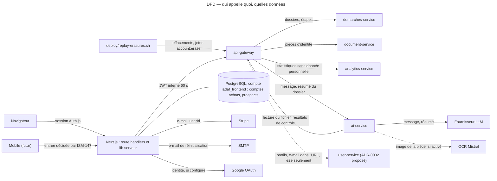

# Inventaire des routes REST et de leurs appelants

Liste de chaque route REST du backend et du front Next.js sur `dev_v1` à `c0c70d8`
(2026-11-19) : appelant, rôle requis, données personnelles, cible. Point de départ de l'epic
PIL-21 ; alimente ISM-147 (entrée et authentification de l'API mobile) et ISM-142 (conventions
d'API).

## Lecture

- **Périmètre** : routes métier. Hors tableaux : les `/actuator/health` des services Spring
  (sans jeton) et `/docs`, `/redoc`, `/openapi.json` d'`ai-service` (sans jeton, port 8086,
  non routés par la passerelle).
- **Chemin** : chemin vu par la passerelle (`/api/...`) ; la passerelle retire `/api` avant
  le service.
- **Appelant** :
  - `front` : code serveur Next.js (`front/src/app/lib`, route handlers) ;
  - `ai` : `ai-service` ;
  - `ops` : `deploy/replay-erasures.sh`, rejeu des effacements après une restauration ;
  - `e2e` : `tests/e2e` ; `test` : tests unitaires ou d'intégration ;
  - aucun appelant mobile : l'entrée du mobile est décidée par ISM-147.
- **Rôle** : tous les services Spring et `ai-service` exigent le jeton interne HS256 (60 s,
  `iss=iadaf-frontend`, `aud=iadaf-backend`) signé par Next.js. `jeton` = jeton valide sans
  scope ; `propriétaire` = l'identifiant vient du `sub` et filtre les données.
- **Données personnelles** : en entrée ou en sortie. **Gras** = donnée dans le chemin ou la
  requête de l'URL, donc dans les logs : la passerelle journalise chaque URI au niveau INFO
  (`LoggingFilter`). Critère : toute valeur liée à une personne (identifiant, e-mail, langue,
  pays, démarche suivie).
- **Destinataire tiers** : service hors de la plateforme qui reçoit la donnée.
- **Cible** : garder, fusionner, supprimer ou à décider, avec la décision qui la fonde.

## demarches-service (12)

`DemarcheController.java`. `DemarcheDTO` contient : userId, description, numéro de référence,
organisme concerné, notes (texte libre), date d'échéance, commentaires.

| Méthode | Chemin | Appelant | Rôle | Données personnelles | Cible |
|---|---|---|---|---|---|
| DELETE | `/api/demarches/me` | front (effacement du compte), ops, e2e | `account:erase` | sortie : nombre supprimé | garder |
| PUT | `/api/demarches/packs/{packSlug}` | front (`lib/demarches.ts`) | propriétaire | **démarche suivie dans l'URL** (`packSlug`, ex. titre de séjour) ; `DemarcheDTO` | garder |
| PUT | `/api/demarches/packs/{packSlug}/etapes` | front (après dépôt ou suppression d'un document) | propriétaire | **démarche suivie dans l'URL** ; `DemarcheDTO` | garder |
| GET | `/api/demarches` | front (tableau de bord, mes dossiers), e2e | propriétaire | `DemarcheDTO[]` | garder |
| POST | `/api/demarches` | aucun | propriétaire | `DemarcheDTO` | garder (ADR-0001, décision 2) |
| GET | `/api/demarches/{id}` | aucun | propriétaire | `DemarcheDTO` | garder (ADR-0001, décision 2) |
| PUT | `/api/demarches/{id}` | aucun | propriétaire | `DemarcheDTO` | garder (ADR-0001, décision 2) |
| DELETE | `/api/demarches/{id}` | aucun | propriétaire | suppression logique (`active=false`) : la donnée reste jusqu'à l'effacement du compte | garder (ADR-0001, décision 2) |
| GET | `/api/demarches/statut/{statut}` | aucun | propriétaire | `DemarcheDTO[]` | garder (ADR-0001, décision 2) |
| GET | `/api/demarches/type/{type}` | aucun | propriétaire | **type de démarche dans l'URL** ; `DemarcheDTO[]` | garder (ADR-0001, décision 2) |
| PATCH | `/api/demarches/{id}/statut` | aucun | propriétaire | `DemarcheDTO` | garder (ADR-0001, décision 2) |
| GET | `/api/demarches/retard` | aucun | propriétaire | `DemarcheDTO[]` | garder (ADR-0001, décision 2) |

## document-service (5)

`DocumentController.java`. Les fichiers sont des pièces d'identité et des justificatifs.

| Méthode | Chemin | Appelant | Rôle | Données personnelles | Cible |
|---|---|---|---|---|---|
| POST | `/api/documents` (multipart) | front (`api/documents`) | propriétaire | entrée : fichier ; sortie : nom d'origine, type | garder |
| GET | `/api/documents?packSlug=` | front (pages pack et documents), e2e | propriétaire | **démarche suivie dans l'URL** ; `DocumentDTO[]` (noms de fichiers) | garder |
| GET | `/api/documents/{id}/content` | front (`api/documents/[id]`), ai, e2e | propriétaire (404 sinon) | sortie : contenu du fichier | garder |
| DELETE | `/api/documents/{id}` | front (`api/documents/[id]`), e2e | propriétaire | aucune (204) | garder |
| DELETE | `/api/documents/me` | front (effacement du compte), ops, e2e | `account:erase` | sortie : nombre supprimé | garder |

## analytics-service (3)

`DocumentCheckStatsController.java`. Statistiques agrégées, sans identifiant d'utilisateur.

| Méthode | Chemin | Appelant | Rôle | Données personnelles | Cible |
|---|---|---|---|---|---|
| POST | `/api/analytics/document-checks` | ai (`documents/stats.py`) | jeton | aucune (catégorie, contrôles) | garder |
| POST | `/api/analytics/document-checks/disputes` | front (`api/precheck/disputes`) | jeton | aucune | garder |
| GET | `/api/analytics/document-checks?days=` | e2e seulement | `analytics:read` (émis par aucun code applicatif) | aucune (agrégats) | garder |

## user-service (8)

`UserController.java`, scope `admin` sur toute la classe ; aucun code applicatif n'émet ce scope.
Table `profiles.users` ; les comptes réels vivent dans le schéma `users` du front. Aucun service
Spring n'a d'OpenAPI.

Cible : l'ADR-0001 (étape 1) supprime le service ; l'ADR-0002 (proposé, ISM-107, pas encore
sur `dev_v1`) le garderait et le referait (étape 3) : les comptes et l'authentification y
arrivent, ces 8 routes et `profiles.users` disparaissent.

| Méthode | Chemin | Appelant | Rôle | Données personnelles | Cible |
|---|---|---|---|---|---|
| POST | `/api/users` | aucun | `admin` | e-mail, nom, prénom, téléphone, pays, ville, statut actuel, niveau de français, langue, notes | supprimer (ADR-0002, étape 3) |
| GET | `/api/users` | e2e, test de la passerelle | `admin` | liste complète des profils | supprimer (ADR-0002, étape 3) |
| GET | `/api/users/{id}` | aucun | `admin` | profil | supprimer (ADR-0002, étape 3) |
| GET | `/api/users/email/{email}` | e2e | `admin` | **e-mail dans l'URL**, aussi journalisé par `UserController` et `UserService` | supprimer (ADR-0002, étape 3) |
| PUT | `/api/users/{id}` | aucun | `admin` | profil | supprimer (ADR-0002, étape 3) |
| DELETE | `/api/users/{id}` | e2e (attend 403) | `admin` | aucune | supprimer (ADR-0002, étape 3) |
| GET | `/api/users/langue/{langue}` | aucun | `admin` | **langue dans l'URL** ; sortie : profils | supprimer (ADR-0002, étape 3) |
| GET | `/api/users/pays/{pays}` | aucun | `admin` | **pays d'origine dans l'URL** (peut révéler l'origine) ; sortie : profils | supprimer (ADR-0002, étape 3) |

## ai-service (8)

FastAPI, préfixe `/ai`. Tout sauf la santé et la documentation (`/docs`, `/redoc`,
`/openapi.json`) exige le jeton interne (`frontend_claims`). Le proxy
Next.js `/api/ai/[...path]` ouvre `chat`, `chat/stream`, `translate`, `analyze-document` et
`health`, mais le front n'appelle que `chat/stream` et `analyze-document`. Destinataire tiers :
le fournisseur LLM (compatible OpenAI, `llm_service.py`).

| Méthode | Chemin | Appelant | Rôle | Données personnelles | Cible |
|---|---|---|---|---|---|
| GET | `/ai/health` (port 8086, hors passerelle) | Docker, Eureka, e2e | aucun | aucune | garder |
| GET | `/actuator/health` (port 8086, hors passerelle) | aucun | aucun | aucune | à décider (ISM-142) |
| POST | `/api/ai/chat` | e2e, test de la passerelle | jeton, `sub` facultatif | message libre (peut contenir toute donnée) ; tiers : LLM | à décider (ISM-142) : doublon de `chat/stream` |
| POST | `/api/ai/chat/stream` | front (proxy), e2e | jeton, `sub` facultatif | message libre, sortie SSE ; tiers : LLM | garder |
| POST | `/api/ai/translate` | aucun | jeton | texte libre ; tiers : LLM | à décider (ISM-142) |
| POST | `/api/ai/analyze-document` | front (proxy) | jeton, anonyme accepté | texte libre ; le front envoie un résumé du dossier (pack, noms des pièces, contrôles), sans contenu lu ; tiers : LLM | garder, recadrée (ADR-0001, décision 3) |
| DELETE | `/api/ai/users/{user_id}/data` | front (effacement du compte), ops, e2e | `account:erase` et `sub == user_id` | **identifiant de compte dans l'URL** | garder, aligner sur `/me` (ISM-142) |
| POST | `/api/ai/documents/{document_id}/analyze` | front (`api/documents/[id]/analyze`), e2e | jeton avec `sub` | lit le fichier via la passerelle ; sortie : contrôles, sans contenu ; tiers : OCR Mistral si l'OCR est configuré (image de la pièce) | garder |

## Routes Next.js (19, lecture seule)

`front/src/app/api`, propriété de l'équipe front : cible hors périmètre backend.
Seules les routes marquées → appellent la passerelle.

| Méthodes | Chemin | Contrôle | Appel | Données personnelles |
|---|---|---|---|---|
| GET, POST | `/api/auth/[...nextauth]` | Auth.js | base ; tiers : Google (si configuré) | e-mail, mot de passe |
| POST | `/api/auth/register` | limite par IP | base | e-mail, nom, mot de passe |
| POST | `/api/auth/password-reset/request` | limite par IP et e-mail | base ; tiers : SMTP | e-mail |
| POST | `/api/auth/password-reset/confirm` | limite par IP | base | jeton, mot de passe |
| GET, PATCH, DELETE | `/api/account` | session ; DELETE : e-mail ressaisi | base ; DELETE → effacement ai, demarches, documents | nom, e-mail |
| POST | `/api/account/password` | session, limite | base | mots de passe |
| GET | `/api/account/purchases` | session | base | achats |
| DELETE | `/api/account/sessions` | session | base | aucune |
| GET | `/api/entitlements` | session | base | packs achetés |
| GET | `/api/health` | aucun | base | aucune |
| POST | `/api/leads` | limite par IP | base | e-mail |
| POST | `/api/leads/unsubscribe` | jeton dans le corps | base | jeton |
| POST | `/api/checkout` | session | tiers : Stripe | e-mail, userId (métadonnées Stripe) |
| POST | `/api/stripe/webhook` | signature Stripe | base | userId, pack, montant |
| tous | `/api/ai/[...path]` | session facultative, liste blanche | → `/api/ai/*` | message, résumé du dossier |
| GET, DELETE | `/api/documents/[id]` | session | → `/api/documents/{id}`, `/content`, étapes | fichier |
| POST | `/api/documents` | session, limite, accès au pack | → `/api/documents`, étapes | fichier |
| POST | `/api/documents/[id]/analyze` | session, limite | → `/api/ai/documents/{id}/analyze` | aucune |
| POST | `/api/precheck/disputes` | session, limite | → `/api/analytics/document-checks/disputes` | aucune |

`base` = PostgreSQL, compte `iadaf_frontend` : schémas `users`, `billing`, `erasures`,
`ratelimit` (clés HMAC, 48 h).

## Qui appelle quoi, quelles données

## Constats

- **NFR-1 — aucune donnée personnelle dans l'URL** (chemin ou requête), à reprendre dans
  ISM-142. Routes concernées aujourd'hui : `user-service` (e-mail, langue, pays ; refait par
  l'ADR-0002), `DELETE /api/ai/users/{user_id}/data` (identifiant de compte) et les routes avec
  `packSlug` ou `type` (démarche suivie).
- **Routes IA sans appelant applicatif** : `chat` (doublon de `chat/stream`), `translate`,
  `/actuator/health`.
- **Routes d'effacement** : `deploy/replay-erasures.sh` appelle les trois routes ; tout
  changement de leurs chemins met à jour ce script.
- **Destinataires tiers** : fournisseur LLM, OCR Mistral (si configuré), Stripe, SMTP,
  Google OAuth (si configuré).
- **Scopes sans émetteur** : `admin` et `analytics:read` ne sont émis que par les jetons e2e.
- **Aucun appel entre services Spring** ; seul `ai-service` rappelle la passerelle avec le
  jeton de l'appelant.
- **Commentaire obsolète** : `GatewayConfig.java` dit que `document-service` n'expose aucune
  route ; il en expose 5.
